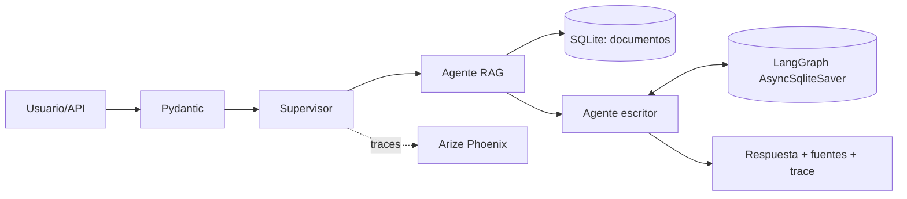

# Intelligence System

Sistema de IA listo para ejecución local: RAG híbrido persistente, orquestación multiagente con LangGraph, API FastAPI validada con Pydantic, memoria conversacional y trazabilidad opcional en Arize Phoenix.

## Arranque

```sh
docker compose up --build
```

API: `http://localhost:8000/docs`. Phoenix: `http://localhost:6006`.

En Windows también podés usar `./run.ps1`. El comando no necesita una clave API: la respuesta local determinista permite probar el flujo completo.

```sh
curl -X POST http://localhost:8000/v1/chat -H "Content-Type: application/json" -d '{"message":"¿Cómo pido acceso VPN?","thread_id":"demo-1"}'
```

Sin `OPENAI_API_KEY`, el sistema conserva todas las capacidades de recuperación, agentes y API usando una respuesta fundamentada determinista. Con una clave en `.env` (copiar desde `.env.example`), el agente escritor usa el modelo configurado. Las configuraciones e IDs se reciben por variables de entorno; no hay secretos ni IDs de servicios hardcodeados.

## Arquitectura



## Decisiones de producción

- Endpoints y esquemas de entrada/salida son `async` y están validados por Pydantic.
- La búsqueda combina coincidencia léxica y similitud vectorial local; los documentos se persisten en SQLite.
- `AsyncSqliteSaver` conserva el estado de cada `thread_id` tras reiniciar el proceso; el escritor utiliza los seis últimos mensajes como historial.
- La instrumentación Phoenix se activa con `PHOENIX_COLLECTOR_ENDPOINT`, sin convertir la observabilidad en un punto único de fallo.
- `POST /v1/documents` permite incorporar o actualizar conocimiento, incluyendo metadatos, sin modificar código. Todas las entradas, salidas y el contrato de la herramienta RAG tienen modelos Pydantic.
- El cliente LLM es asíncrono, reintenta hasta tres veces ante fallos transitorios y devuelve un `503` controlado si no se recupera.

## API de conocimiento

```sh
curl -X POST http://localhost:8000/v1/documents -H "Content-Type: application/json" -d '{"document_id":"vacaciones","title":"Licencias","content":"Las licencias se solicitan desde el portal interno con al menos diez días de anticipación.","metadata":{"area":"rrhh"}}'
```

## Cinco pruebas manuales sugeridas para Phoenix

1. Consulta VPN: `¿Cómo solicito acceso VPN?`
2. Restablecimiento: `Olvidé mi contraseña`
3. Incidente: `Detecté un incidente de seguridad`
4. Pregunta sin cobertura: `¿Cuál es el menú del comedor?`
5. Repetir la consulta VPN con el mismo `thread_id` para inspeccionar el checkpoint.

Las trazas aparecen en el proyecto `intelligence-system` de Phoenix. Para ejecutar las pruebas automatizadas: `pytest -q`. La suite cubre recuperación híbrida, ingesta/validación, el enrutamiento y memoria del grafo, y el contrato HTTP.
Tras levantar los servicios, también podés ejecutar las cinco solicitudes reproducibles con `sh scripts/run_observability_checks.sh` o, en Windows, `./scripts/run_observability_checks.ps1`.
