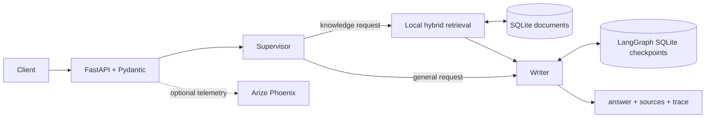

# Architecture

## Purpose

Intelligence System is a local-first internal-knowledge API. It retrieves relevant procedures, generates a grounded Spanish response, and returns the sources and a compact execution trace with every answer.

## Request flow

`POST /v1/documents` writes validated documents to the same SQLite database used by retrieval. `POST /v1/chat` selects a route, retrieves sources when appropriate, and writes conversation state under the supplied `thread_id`.

## Components and boundaries

- **FastAPI** is the public HTTP boundary; Pydantic constrains request and response payloads.
- **LocalRAG** persists documents in SQLite and blends lexical overlap with a deterministic local vector representation. It does not call an embedding provider.
- **LangGraph** coordinates the supervisor, researcher, and writer. `AsyncSqliteSaver` persists per-thread state.
- **OpenAI is optional.** Without `OPENAI_API_KEY`, the project remains executable with deterministic grounded responses. With a key, only the supervisor and writer prompts are sent to the configured provider.
- **Phoenix is optional.** The collector endpoint enables tracing but a tracing failure must not make the API unavailable.

## Data and security

The project stores only the knowledge documents and conversation checkpoints in the configured local database. API keys belong in an ignored `.env` file or deployment-secret store. The repository deliberately ships only placeholder configuration in `.env.example`; no production data, database, or telemetry export is versioned.
